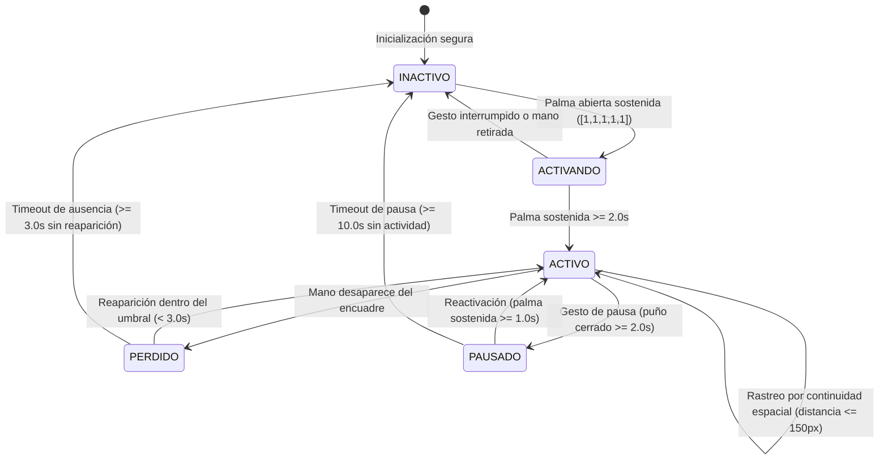

# Estrategia de Aislamiento de Usuario Activo en Entornos Multi-Persona

**Proyecto:** Control de Interfaz de Usuario mediante Visión Artificial  
**Autores:** Victor Sánchez, Crisarys Vasquez, Juan Gonzalez, Alexandra Esteves  
**Institución:** Universidad Tecnológica de Panamá (UTP) — Tópicos Especiales I  

---

## 1. Justificación y Planteamiento del Problema

En aplicaciones reales de visión artificial aplicadas a la interacción Hombre-Máquina (HCI), las estaciones de trabajo no se encuentran en entornos asépticos ni individuales:
- **Quirófanos y entornos hospitalarios:** El cirujano interactúa frente a un monitor para visualizar estudios de tomografía o resonancias magnéticas (DICOM), mientras personal de enfermería, anestesiología e instrumentistas se mueven dentro del encuadre de la cámara.
- **Aulas de clase y auditorios:** El docente o presentador gesticula frente a una pantalla mientras estudiantes o asistentes pasan por delante o gesticulan en el campo de visión.
- **Plantas de producción industrial:** Múltiples operarios comparten zonas de control o supervisión de maquinaria.

Un sistema elemental que simplemente procese una mano (`max_num_hands=1`) o un rostro (`max_num_faces=1`) presentará **comportamiento errático y peligroso**: cambiará de usuario arbitrariamente entre frames y procesará movimientos no deseados de personas ajenas a la tarea.

> [!CAUTION]
> **En un quirófano, un clic no intencionado provocado por la mano de un asistente puede alterar parámetros críticos de un procedimiento o cambiar la visualización médica en un momento decisivo.**

---

## 2. Evaluación Comparativa de Estrategias

| Estrategia | Cómo funciona | Ventajas | Limitación / Riesgo |
|---|---|---|---|
| **1. Limitar detección** | `num_hands=1` y `num_faces=1` en MediaPipe | Fácil de configurar, bajo consumo de cómputo | Elige una mano de forma no determinista, alternando entre personas si ambas están en el encuadre. |
| **2. Usuario más cercano** | Elegir la mano o rostro con mayor área en el encuadre (mayor tamaño = más cerca) | Intuitivo; suele favorecer a la persona frente al puesto | Un transeúnte o asistente que cruce por delante roba instantáneamente el control. |
| **3. Zona de interacción (ROI)** | Delimitar un recuadro fijo en el encuadre donde se aceptan gestos | Ignora personas fuera de la zona | Restringe la movilidad natural y obliga al usuario a mantener su mano en un área fija. |
| **4. Gesto de activación** | El usuario "toma el control" con una postura deliberada (ej. palma abierta 2 s) | Evita clics involuntarios al iniciar; difícil de ejecutar por accidente | Por sí solo, no previene que una segunda persona interfiera una vez que el sistema está encendido. |
| **5. Bloqueo de usuario (User Lock)** | Tras la activación, se asocia el control al centroide y se ignora al resto de personas | Aislamiento determinista; resistencia a transeúntes | Si el usuario oculta la mano o sale del encuadre, se requiere una política de reconexión o timeout. |

---

## 3. Arquitectura Híbrida Recomendada e Implementada

El sistema implementado en `user_lock.py` fusiona **tres estrategias complementarias** en una máquina de estados determinista:

### Capa 1: Gesto de Activación con Priorización por Proximidad
- El sistema arranca en estado `INACTIVO` (inseguro ante falsos positivos).
- Si varias personas muestran gestos en el encuadre, el algoritmo calcula el área del bounding box de cada mano:
  $$\text{Área} = (\max(X) - \min(X)) \times (\max(Y) - \min(Y))$$
- La mano con mayor área (la más cercana) es seleccionada como candidata.
- Se requiere sostener la palma abierta durante **2.0 segundos** continuos, desplegando una barra de carga en el HUD.

### Capa 2: Bloqueo por Continuidad Espacial
- MediaPipe se configura para detectar múltiples manos (`max_num_hands=2`).
- Al entrar a `ACTIVO`, se calcula y bloquea el centroide cinemático de los 21 landmarks:
  $$C = \left(\frac{1}{21}\sum_{i=0}^{20} x_i, \; \frac{1}{21}\sum_{i=0}^{20} y_i\right)$$
- En cada frame sucesivo, se calcula la distancia euclidiana entre cada mano detectada y el último centroide:
  $$d_k = \sqrt{(x_{c,k} - x_{bloq})^2 + (y_{c,k} - y_{bloq})^2}$$
- Solo la mano con distancia mínima y $d_k \le 150\text{ px}$ se procesa como usuario activo. Cualquier otra mano presente en la escena se clasifica como intruso y se descarta automáticamente.

### Capa 3: Tolerancia Temporal, Pausa Explícita y Liberación Automática
- **Tolerancia a oclusiones breves (`PERDIDO`):** Si la mano del operador sale del campo visual o se oculta momentáneamente, el sistema mantiene la posición previa por **3.0 segundos**. Si la mano reaparece cerca, el control se restituye sin interrupciones.
- **Pausa de seguridad (`PAUSADO`):** Un puño cerrado sostenido durante **2.0 segundos** congela el cursor y detiene cualquier acción en el sistema operativo. Permite al cirujano o expositor manipular objetos físicos o hablar gesticulando libremente.
- **Liberación automática:** Al cumplirse el timeout de 3.0 s en ausencia o 10.0 s en pausa, el sistema vuelve a `INACTIVO`, garantizando que ninguna persona tome el control sin autorización.

---

## 4. Consideraciones de Dominio y Seguridad Clínica

### ¿Por qué el modo gestual supera al modo ocular en Quirófanos?
1. **Mascarillas y Gorros Quirúrgicos:** El protocolo estéril exige el uso de mascarillas que cubren nariz y boca, y gorros que cubren frente y cejas. Esto distorsiona severamente los puntos de referencia faciales de modelos como Face Mesh, reduciendo drásticamente su precisión.
2. **Anonimato de Modelos de Detección:** Ni MediaPipe Face Mesh ni MediaPipe Iris realizan reconocimiento biométrico facial (Face ID); no distinguen si el rostro detectado pertenece al cirujano o al instrumentista. Por lo tanto, el seguimiento manual con bloqueo de sesión explícito resulta considerablemente más seguro y determinista.
3. **Ergonomía de Descanso:** El cirujano puede pausar con el puño cerrado cada vez que requiere intervenir directamente sobre el campo quirúrgico, evitando acciones involuntarias sobre la pantalla de control.

---

## 5. Parámetros de Calibración

Los parámetros del módulo `UserLock` son completamente parametrizables:

| Parámetro | Valor por Defecto | Justificación |
|---|---|---|
| `activation_time_s` | 2.0 s | Suficientemente largo para evitar activaciones casuales; cómodo para el operador. |
| `reactivation_time_s` | 1.0 s | Permite retomar el control rápidamente una vez que el usuario ya estaba autenticado. |
| `lost_timeout_s` | 3.0 s | Tolera parpadeos de detección o ajustes breves de postura de la mano. |
| `pause_gesture_time_s` | 2.0 s | Evita que un puño cerrado accidental durante un clic dispare la pausa. |
| `pause_timeout_s` | 10.0 s | Si la sesión queda pausada sin uso prolongado, se revoca el control. |
| `continuity_threshold_px` | 150 px | A 30 FPS, la mano de un operador no salta más de 150 px entre cuadros continuos. |
