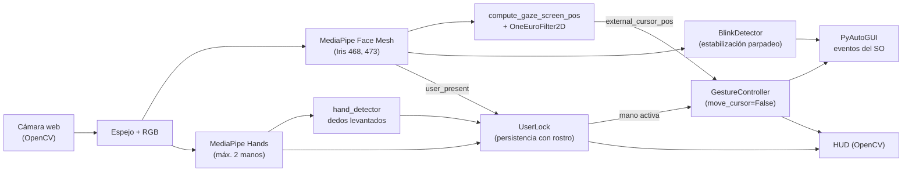
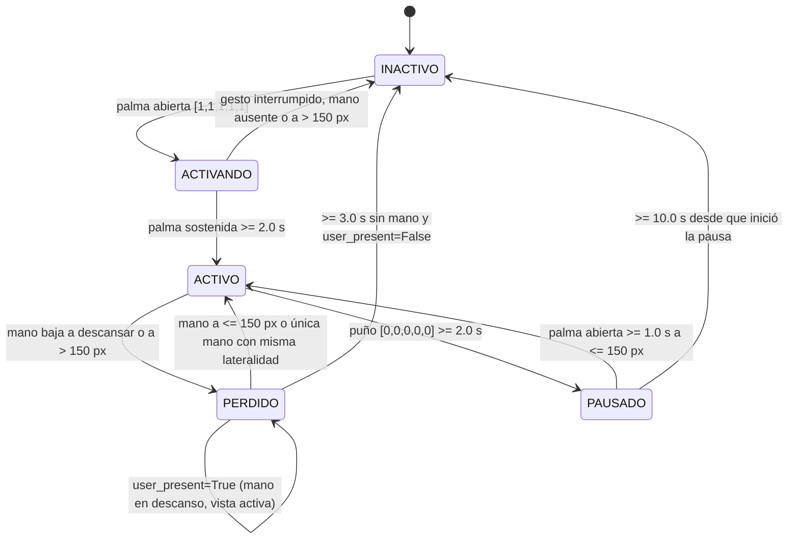

# Control del Cursor mediante Gestos Manuales con Aislamiento de Usuario Activo para Entornos Multi-Persona

**Victor Sánchez, Crisarys Vasquez, Juan Gonzalez y Alexandra Esteves**
Facultad de Ingeniería de Sistemas Computacionales, Universidad Tecnológica de Panamá (UTP), Grupo 1IL143
Curso: Tópicos Especiales I (Visión Artificial), 2.º semestre de 2026

---

**Resumen—** Este documento describe el diseño, la implementación y la verificación de un sistema multimodal en Python que controla el cursor mediante la vista del usuario (seguimiento de iris con MediaPipe Face Mesh) y ejecuta los eventos del ratón (clic izquierdo, clic derecho, arrastre y desplazamiento) a partir de los gestos de la mano (MediaPipe Hands), capturados con una cámara web convencional. Su aporte principal abarca tres ejes. Primero, un módulo de aislamiento de usuario activo (*User Lock*), modelado como una máquina de estados finitos de cinco estados con persistencia por presencia facial, que decide qué mano controla el sistema en entornos multi-persona y permite descansar el brazo sin perder la sesión. Segundo, una combinación de técnicas de estabilización contra el desplazamiento involuntario del cursor al hacer clic (*click drift*) y al parpadear: anclaje en el nudillo del índice, filtro One Euro tanto para la mirada como para la mano, histéresis dual con distancia normalizada, congelamiento del cursor pre-pellizco/pre-parpadeo y zona muerta de arrastre. Tercero, un esquema ergonómico de interacción *Gaze + Relaxed Pinch* para mitigar la fatiga muscular del brazo (*Gorilla Arm*). La suite de 72 pruebas unitarias del proyecto se ejecutó sin fallos. No se realizó una evaluación experimental cuantitativa con usuarios; esta limitación y otras halladas durante la revisión del código se documentan en la Sección VII.

**Términos de índice—** Interacción humano-computadora, interfaz sin contacto, seguimiento ocular, seguimiento de manos, fatiga de brazo, MediaPipe, filtro One Euro, máquina de estados, visión artificial.

---

## I. Introducción

### A. Contexto y motivación

Las interfaces tradicionales dependen de periféricos físicos (ratón, teclado, pantalla táctil), lo que limita su uso cuando las manos del usuario deben permanecer libres de contacto o cuando el hardware especializado de seguimiento resulta costoso. En entornos quirúrgicos, la interacción sin contacto con visores de imágenes médicas permite que el cirujano navegue estudios de radiología sin romper la esterilidad. Wachs *et al.* [1] presentaron "Gestix", un sistema de reconocimiento de gestos de mano basado en video para navegar imágenes de un expediente médico electrónico, probado durante un procedimiento de biopsia cerebral. Mewes *et al.* [2] revisaron sistemáticamente 55 trabajos sobre interacción sin contacto (gestos, voz y seguimiento ocular) en quirófanos y salas de radiología intervencionista, y reportaron que solo 8 sistemas (14.5 %) se habían probado en un entorno clínico real y 7 (12.7 %) no se habían evaluado.

Este proyecto parte de esa línea de trabajo, pero se plantea con una cámara web convencional y software de código abierto, y orienta el diseño a tres problemas prácticos críticos en interfaces sin contacto: la presencia simultánea de varias personas frente a la cámara, la deriva del cursor al ejecutar clics y la fatiga muscular de mantener el brazo levantado en el aire.

### B. Planteamiento del problema

Se identificaron tres problemas de ingeniería:

1. **Selección del usuario en escenas multi-persona.** Un detector configurado para una sola mano (`max_num_hands=1`) elige de forma no determinista entre las manos visibles, por lo que el control puede pasar de una persona a otra entre cuadros consecutivos.
2. **Desplazamiento involuntario al hacer clic (*click drift*).** Al juntar pulgar e índice (o al cerrar los párpados en un parpadeo), el movimiento anatómico desplaza el punto de referencia que guía el cursor y lo aleja del objetivo justo antes del clic.
3. **Fatiga muscular del brazo en interacciones aéreas (*Gorilla Arm syndrome*).** Mantener la mano suspendida en el aire a la altura de la cámara con el dedo índice rígidamente extendido para desplazar el cursor produce agotamiento rápido del deltoides, cuantificado por Hincapié-Ramos *et al.* [15] mediante la métrica *Consumed Endurance*.

### C. Objetivos

El objetivo general de la propuesta académica del equipo fue un sistema multimodal que combina rastreo ocular/facial para el posicionamiento del cursor y gestos manuales para los clics y funciones del ratón. La Tabla I resume el estado de cada objetivo específico en la versión actual del código.

**TABLA I. Estado de los objetivos específicos de la propuesta**

| Objetivo específico (propuesta) | Estado en el código actual |
|---|---|
| Rastrear rostro e iris para estimar la mirada | Implementado (`main.py`, `main_ocular.py`, `blink_detector.py`) con MediaPipe Face Mesh (`refine_landmarks=True`, landmarks 468 y 473) |
| Implementar el modelo de puntos clave de la mano para gestos espaciales | Implementado (`main.py`, `hand_detector.py`) |
| Diseñar gestos manuales para clic, arrastre y mitigación de fatiga (*Gaze + Pinch*) | Implementado (`gesture_controller.py`, `user_lock.py`) con soporte de pinza relajada y descanso de mano en escritorio |
| Calibración e interpolación espacial hacia la resolución del monitor | Implementado: interpolación lineal con sensibilidad ajustable en vivo y calibración dinámica de parpadeo (`BlinkDetector`) |
| Aplicar filtrado espacial y temporal (One Euro) | Implementado tanto para el cursor ocular (`gaze_filter`) como para el modo gestual |
| Evaluar latencia, cuadros por segundo y precisión de selección | No realizado de forma sistemática con usuarios (el HUD muestra los FPS en pantalla, sin registro experimental) |

### D. Alcance y contribuciones

El alcance documentado comprende el **sistema híbrido Vista + Manos** (`main.py`), junto con los módulos independientes ocular (`main_ocular.py`) y gestual (`gesture_controller.py`) con aislamiento multi-persona. Las contribuciones son:

- Un módulo `UserLock` con cinco estados (`INACTIVO`, `ACTIVANDO`, `ACTIVO`, `PERDIDO`, `PAUSADO`) con persistencia de sesión asistida por presencia facial (`user_present`) y reconexión por lateralidad, permitiendo descansar la mano sin perder la sesión activa.
- Una arquitectura multimodal *Gaze + Relaxed Pinch* que delega el apuntado continuo a la mirada y permite ejecutar clics con la mano en postura relajada a baja altura [16], [17], mitigando el síndrome de *Gorilla Arm* [15].
- Un controlador gestual y ocular que combina estabilización por filtro One Euro, histéresis dual normalizada, congelamiento pre-pellizco/pre-parpadeo y zona muerta de arrastre.
- Una suite de 72 pruebas unitarias que cubre filtro, histéresis, anclaje, zona muerta, integración híbrida vista-manos, detector de parpadeo, estados del bloqueo y clasificación de dedos.
- Una revisión crítica de las limitaciones del sistema y de las discrepancias entre la documentación previa y el código (Sección VII).

El resto del documento se organiza así: la Sección II presenta el marco teórico; la III, la arquitectura; la IV, el módulo de aislamiento; la V, el controlador híbrido, la estabilización y la mitigación ergonómica; la VI, la verificación; la VII, la discusión; y la VIII, las conclusiones.

---

## II. Marco Teórico y Trabajos Relacionados

### A. Interacción sin contacto en entornos clínicos

Los trabajos [1] y [2] establecen el contexto de aplicación: la necesidad de manipular imágenes médicas sin contacto físico y la brecha entre prototipos técnicos y evaluación clínica real. Esta brecha implica que cualquier afirmación de idoneidad quirúrgica de un sistema nuevo debe tratarse como hipótesis hasta que exista una evaluación en ese entorno. Este proyecto no cuenta con tal evaluación.

### B. Estimación de pose de mano con MediaPipe

MediaPipe es un marco para construir canalizaciones de percepción [4]. MediaPipe Hands [3] estima el esqueleto de la mano a partir de una sola cámara RGB mediante dos modelos: un detector de palma que entrega un cuadro delimitador orientado, y un modelo de puntos clave que recibe el recorte de la mano y devuelve 21 puntos con coordenadas 2.5D. En seguimiento continuo, el cuadro delimitador del cuadro actual se deriva de los puntos del cuadro anterior, y el detector solo se invoca en el primer cuadro o cuando se pierde la mano [3]. La guía oficial [5] describe la versión actual de la solución (*Hand Landmarker*).

El proyecto usa la API heredada `mediapipe.python.solutions.hands`. La documentación del repositorio de MediaPipe indica que, desde el 1 de marzo de 2023, esa solución fue actualizada a una nueva solución de MediaPipe [6]. El código no se migró (ver Sección VII).

### C. Filtrado de señales ruidosas: filtro One Euro

Casiez, Roussel y Vogel [7] proponen el filtro 1€, un filtro paso bajo de primer orden cuya frecuencia de corte se adapta a la velocidad de la señal: a baja velocidad usa una frecuencia de corte baja para reducir el temblor, y a alta velocidad la aumenta para reducir el retardo. Sus dos parámetros son la frecuencia de corte mínima $f_{c_{\min}}$ y el coeficiente de velocidad $\beta$. Los autores recomiendan un procedimiento de ajuste en dos pasos: fijar $\beta = 0$ y ajustar $f_{c_{\min}}$ con la mano quieta, y luego aumentar $\beta$ con movimientos rápidos hasta minimizar el retardo; además, el orden de magnitud de $\beta$ depende de los datos y sus unidades [7]. Rashad [8] documenta la integración de este filtro para estabilizar puntos clave de MediaPipe en un proyecto de captura de movimiento facial.

### D. Fatiga muscular en interacciones aéreas (*Gorilla Arm*) y paradigma *Gaze + Pinch*

Hincapié-Ramos *et al.* [15] introdujeron la métrica *Consumed Endurance* (CE) para cuantificar la fatiga del hombro en interacciones espaciales a mano alzada, demostrando que mantener el brazo extendido frente al cuerpo o a la altura de la cámara agota rápidamente la reserva muscular. Para mitigar este efecto, Chatterjee, Xiao y Harrison [16] propusieron combinar seguimiento ocular con gestos manuales en el espacio libre (*Gaze+Gesture*), delegando la selección espacial gruesa y rápida a la mirada y reservando la mano para gestos discretos y cortos. De forma complementaria, Pfeuffer *et al.* [17] formalizaron el paradigma *Gaze + Pinch*, en el cual los ojos apuntan al objetivo y un pellizco manual relajado a baja altura confirma el clic o inicia el arrastre, evitando sostener el brazo elevado.

### E. Técnicas de diseño propias del proyecto

La histéresis con confirmación temporal, la normalización por tamaño de mano, la zona muerta de arrastre, el congelamiento del cursor pre-pellizco/pre-parpadeo y la máquina de estados de `UserLock` con persistencia por presencia facial son decisiones de diseño del equipo adaptadas a una cámara web convencional.

---

## III. Arquitectura del Sistema

### A. Visión general

**TABLA II. Módulos del proyecto**

| Archivo | Responsabilidad |
|---|---|
| `main.py` | Bucle híbrido principal: une Vista (`FaceMesh` + `compute_gaze_screen_pos` + `BlinkDetector`) con Manos (`Hands` + `UserLock` + `GestureController`), HUD y teclado |
| `main_ocular.py` | Módulo ocular autónomo y función reutilizable `compute_gaze_screen_pos` |
| `blink_detector.py` | Detección de parpadeo con umbrales dinámicos relativos a la apertura basal y congelamiento pre-parpadeo |
| `hand_detector.py` | Clasificación de dedos levantados, nombre del gesto, panel HUD |
| `user_lock.py` | Máquina de estados de aislamiento de usuario con persistencia por presencia facial (`user_present`) y reconexión por lateralidad |
| `gesture_controller.py` | Modos de interacción (incluyendo pinza relajada en modo híbrido), filtro One Euro, detector de pellizco con histéresis, anti-drift, arrastre y desplazamiento |
| `test_*.py` | 72 pruebas unitarias con `unittest` (`test_gesture_controller.py`, `test_user_lock.py`, `test_blink_detector.py`, `test_hand_detector.py`) |

### B. Pila tecnológica

- **Python 3.12** (la ejecución verificada en este documento usó Python 3.12.10).
- **OpenCV** [9] para captura de video, volteo horizontal, conversión BGR→RGB y dibujo del HUD.
- **MediaPipe Face Mesh** [4], [14] (`refine_landmarks=True`) para el seguimiento de los iris (landmarks 468 y 473) y de los párpados.
- **MediaPipe Hands** [3], [4] para la detección de manos y los 21 puntos clave.
- **NumPy** [10] para interpolación lineal (`np.interp`), recorte y distancias.
- **PyAutoGUI** [11] para mover el cursor, hacer clic, arrastrar y desplazar.

El archivo `requirements.txt` lista `opencv-python`, `mediapipe`, `pyautogui` y `numpy` sin versiones fijadas. Como material de apoyo para integrar MediaPipe con OpenCV en la detección de manos se consultó un tutorial en video [12].

### C. Captura y detección multimodal

`main.py` solicita a la cámara una resolución de 640×480, voltea cada cuadro horizontalmente (efecto espejo) y lo convierte a RGB. Sobre ese mismo cuadro se ejecutan `FaceMesh` (`max_num_faces=1`, `refine_landmarks=True`) y `Hands` (`static_image_mode=False`, `max_num_hands=2`, `min_detection_confidence=0.7`, `min_tracking_confidence=0.7`). Se usan dos manos para poder distinguir al usuario activo de un intruso.

### D. Clasificación de dedos

`get_fingers_up` devuelve una lista binaria `[pulgar, índice, medio, anular, meñique]`. Para los cuatro dedos largos, un dedo se considera levantado si la coordenada $y$ de su punta (landmarks 8, 12, 16, 20) es menor que la de su articulación PIP (6, 10, 14, 18), dado que en OpenCV el eje $y$ crece hacia abajo. Para el pulgar se compara la coordenada $x$ de la punta (landmark 4) con la del MCP (landmark 2), con signo según la lateralidad ("Right" o "Left") que reporta MediaPipe sobre la imagen espejada.

### E. Mapeo a coordenadas de pantalla (Vista y Manos)

En el **modo híbrido (`main.py`)** y en el **modo ocular (`main_ocular.py`)**, la función `compute_gaze_screen_pos` calcula la posición normalizada del centro de cada iris (landmarks 468 y 473) dentro de los límites anatómicos de cada ojo (comisuras horizontales y párpados superior/inferior), promedia ambos ojos e interpola hacia la pantalla aplicando un margen efectivo inversamente proporcional a la sensibilidad (`0.08 / sensitivity`), acotando la salida a $[1, W-2] \times [1, H-2]$ y filtrándola con `OneEuroFilter2D`.

En el **modo gestual puro (`move_cursor=True`)**, el cursor se mapea desde una **zona activa** rectangular centrada horizontalmente en el cuadro y a 48 % de su altura:

$$x_{\text{pantalla}} = \operatorname{interp}\big(x_{\text{nudillo}};\,[x_{\min}, x_{\max}] \rightarrow [0, W]\big)$$

y análogamente para $y$, con recorte a $[0, W-1]$ y $[0, H-1]$.

---

## IV. Módulo de Aislamiento de Usuario Activo (*User Lock*) y Descanso Ergonómico

### A. Motivación de diseño

La Tabla III compara las estrategias consideradas por el equipo. Es una evaluación cualitativa de diseño; las estrategias no se implementaron por separado ni se compararon experimentalmente.

**TABLA III. Estrategias de aislamiento consideradas**

| Estrategia | Principio | Limitación identificada |
|---|---|---|
| Limitar la detección (`max_num_hands=1`) | Una sola mano por cuadro | Selección no determinista entre personas |
| Usuario más cercano | Mayor área de la caja de la mano | Quien cruce por delante toma el control |
| Zona fija de interacción | Procesar solo una región | Restringe la ergonomía del operador |
| Gesto de activación | Postura deliberada sostenida | No resuelve la intervención posterior de terceros |
| Bloqueo de usuario con persistencia facial | Seguir al usuario por continuidad espacial y mantener su sesión mientras su rostro sigue presente | Permite bajar la mano a descansar sin perder la sesión |

`UserLock` combina gesto de activación con selección por tamaño, bloqueo por continuidad espacial, reconexión por lateralidad y persistencia de sesión mientras el rostro del usuario permanece frente a la cámara.

### B. Máquina de estados

El sistema inicia en `INACTIVO`: ninguna acción llega al sistema operativo hasta completar la activación.

### C. Algoritmo y mitigación de fatiga al bajar la mano

**Selección del candidato de activación.** En `INACTIVO`, entre las manos con palma abierta se elige la de mayor área de la caja delimitadora de sus 21 puntos, en píxeles:

$$A = \big(\max_i x_i - \min_i x_i\big)\cdot\big(\max_i y_i - \min_i y_i\big)$$

**Continuidad espacial y descanso ergonómico de la mano.** Se calcula el centroide de los 21 puntos:

$$C = \left(\tfrac{1}{21}\textstyle\sum_{i=0}^{20} x_i,\; \tfrac{1}{21}\sum_{i=0}^{20} y_i\right)$$

En `ACTIVO`, la mano activa es la que minimiza la distancia euclidiana de su centroide al último centroide bloqueado ($\le 150$ px). Para evitar la fatiga del brazo (*Gorilla Arm* [15]), cuando el usuario baja la mano al escritorio mientras navega con la vista, `UserLock` pasa a `PERDIDO`, pero recibe `user_present=True` desde `FaceMesh`:

1. Mientras `user_present=True`, el temporizador `_lost_start_time` se refresca en cada cuadro, de modo que el usuario puede descansar la mano indefinidamente y seguir moviendo el cursor con los ojos sin que la sesión caiga a `INACTIVO`.
2. Cuando el usuario vuelve a mostrar su mano (por ejemplo, apoyada en el borde inferior del encuadre a nivel del escritorio, fuera del radio de 150 px respecto de donde la bajó), `_handle_lost` restaura `ACTIVO` inmediatamente si la mano está a $\le 150$ px o si es la única mano en escena y coincide con la lateralidad bloqueada (`_locked_handedness`), rechazando manos intrusas de lateralidad distinta.

### D. Parámetros

**TABLA IV. Parámetros de `UserLock` (valores usados en `main.py`)**

| Parámetro | Valor | Función |
|---|---|---|
| `activation_time_s` | 2.0 s | Palma abierta sostenida para activar |
| `reactivation_time_s` | 1.0 s | Palma abierta sostenida para salir de pausa |
| `lost_timeout_s` | 3.0 s | Tiempo máximo en `PERDIDO` cuando `user_present=False` |
| `pause_gesture_time_s` | 2.0 s | Puño cerrado sostenido para pausar |
| `pause_timeout_s` | 10.0 s | Tiempo máximo en `PAUSADO` |
| `continuity_threshold_px` | 150 px | Distancia máxima de centroide entre cuadros |

---

## V. Controlador Híbrido, Estabilización y Pinza Relajada

### A. Modos de interacción y pinza relajada (*Gaze + Pinch*)

El controlador recibe la mano que `UserLock` declara activa cuando el estado es `ACTIVO`, junto con la coordenada ocular opcional `external_cursor_pos`. Cuando `move_cursor=True` (modo gestual puro), el modo se determina estrictamente por el vector de dedos. Cuando `move_cursor=False` (modo híbrido Vista + Manos en `main.py`), la mano no necesita mantener el índice rígidamente extendido para apuntar [16], [17]: cualquier acercamiento pulgar-índice ($d_{\text{norm}} < T_{\text{PRE}}$) con la mano en postura relajada (por ejemplo, gesto "OK" `[0, 0, 1, 1, 1]` o mano semiabierta apoyada en el escritorio, siempre que no sea puño cerrado `[0, 0, 0, 0, 0]`) activa `PUNTERO` para fijar la mirada y ejecutar el clic o arrastre.

**TABLA V. Modos y acciones**

| Vector / Gesto | Modo | Acción |
|---|---|---|
| Índice extendido o pinza relajada pulgar-índice (`move_cursor=False`, no puño) | `PUNTERO` | Pellizco pulgar-índice para clic izquierdo o arrastre sobre la coordenada de la vista (o nudillo si `move_cursor=True`) |
| Índice + medio (`[0,1,1,0,0]` o `[1,1,1,0,0]` sin pellizco) | `SCROLL` | En modo híbrido (`move_cursor=False`): mano quieta como "pedal" y mirada arriba/abajo para deslizar continuamente sin rebote; en modo manual: según $\Delta y$ de la mano |
| Pulgar + índice + medio o pinza relajada pulgar-medio (`move_cursor=False`) | `CLIC_DERECHO` | Pellizco pulgar-medio para clic derecho |
| Puño `[0,0,0,0,0]` o mano abierta sin pellizco | `REPOSO` | Sin acción manual; en modo híbrido sigue actualizando la coordenada base de la vista |

En `SCROLL` dentro del modo híbrido (`move_cursor=False`), sostener el gesto `✌️` actúa como embrague estático: el cursor se fija sobre la ventana actual (`cursor_locked=True`) y la velocidad de desplazamiento (`scroll_amount` entre $\pm 20$ y $\pm 90$) se calcula de forma proporcional a qué tan arriba o abajo mire el usuario respecto de una banda neutra central ($\pm 12\,\%$ de la altura de pantalla), eliminando por completo el efecto de rebote arriba-abajo al reposicionar la mano.

### B. Técnica 1: desacoplamiento ocular-manual y anclaje en el nudillo

En el modo híbrido (`move_cursor=False`), el posicionamiento del cursor proviene del iris (`external_cursor_pos`), completamente desacoplado de la cinemática de los dedos, mientras que el nudillo del índice (landmark 5) sirve únicamente para medir el desplazamiento mayor a `drag_deadzone_px` (15 px) que inicia un arrastre intencional. En el modo gestual puro (`move_cursor=True`), el cursor sigue el landmark 5 en lugar de la punta (landmark 8).

### C. Técnica 2: filtro One Euro

Se implementa el filtro de Casiez *et al.* [7] sobre cada coordenada de pantalla tanto para el seguimiento ocular (`gaze_filter`: $f_{c_{\min}} = 1.2$ Hz, $\beta = 0.015$) como para el seguimiento manual ($f_{c_{\min}} = 1.0$ Hz, $\beta = 0.007$, $d_{\text{cutoff}} = 1.0$ Hz). Con $T_e$ el intervalo entre muestras y $\tau = 1/(2\pi f_c)$:

$$\alpha(T_e, f_c) = \frac{1}{1 + \tau/T_e}, \qquad \hat{x}_i = \alpha\, x_i + (1-\alpha)\,\hat{x}_{i-1}$$

$$f_c = f_{c_{\min}} + \beta\,|\hat{\dot{x}}_i|$$

donde $\hat{\dot{x}}_i$ es la derivada filtrada con una frecuencia de corte fija $d_{\text{cutoff}}$. Adicionalmente, una **zona muerta** de 3 px en `CursorSmoother` ignora desplazamientos menores a ese umbral en reposo.

### D. Técnica 3: histéresis dual con distancia normalizada

La distancia pulgar-índice (puntas, landmarks 4 y 8) se normaliza dividiéndola por una longitud de referencia de la mano, la distancia en píxeles entre la muñeca (landmark 0) y el MCP del dedo medio (landmark 9):

$$d_{\text{norm}} = \frac{\lVert \mathbf{p}_4 - \mathbf{p}_8 \rVert}{\lVert \mathbf{p}_0 - \mathbf{p}_9 \rVert}$$

Esto hace el umbral relativo al tamaño aparente de la mano en la imagen, y por tanto menos sensible a la distancia a la cámara.

El detector usa tres umbrales y confirmación temporal de $N=2$ cuadros:

**TABLA VI. Umbrales del detector de pellizco**

| Umbral | Valor | Efecto |
|---|---|---|
| $T_{\text{PRE}}$ | 0.52 | $d_{\text{norm}} < T_{\text{PRE}}$: congela el cursor (intención de pellizco) |
| $T_{\text{ON}}$ | 0.32 | $d_{\text{norm}} < T_{\text{ON}}$ durante $N$ cuadros: confirma el pellizco |
| $T_{\text{OFF}}$ | 0.45 | $d_{\text{norm}} > T_{\text{OFF}}$ durante $N$ cuadros: libera el pellizco |

La banda $[T_{\text{ON}}, T_{\text{OFF}}]$ evita conmutaciones repetidas por vibraciones pequeñas. Si la longitud de referencia es menor que 25 px, el controlador recurre a umbrales en píxeles (38 y 58).

### E. Técnica 4: congelamiento del cursor y zona muerta de arrastre

1. **Congelamiento pre-pellizco y pre-parpadeo.** Mientras haya pre-pellizco, pellizco o el periodo posterior al clic (0.20 s), el cursor se mantiene congelado en la última coordenada apuntada por la vista (`_locked_cursor_x`, `_locked_cursor_y`) y el clic se ejecuta exactamente en ese punto. De forma complementaria, `BlinkDetector` detecta el inicio del cierre palpebral y bloquea la actualización ocular (`allow_movement=False`) durante los parpadeos involuntarios para evitar saltos verticales del iris.
2. **Discriminación clic/arrastre.** Al confirmarse el pellizco se guarda la posición del anclaje (landmark 5) en cámara. Si el anclaje se desplaza más de 15 px de cámara mientras dura el pellizco, el sistema pasa a arrastre: llama a `pyautogui.mouseDown()` y libera el bloqueo del cursor (`cursor_locked=False`) para que el usuario pueda arrastrar el elemento hacia el destino mirando con la vista. Al soltar el pellizco llama a `pyautogui.mouseUp()`.
3. **Antirrebote del clic.** Un `ClickDebouncer` exige que el pellizco se mantenga 150 ms y aplica un enfriamiento de 300 ms entre clics.
4. **Clic derecho.** Funciona igual, sobre la distancia pulgar-medio y con un detector independiente, en el modo `CLIC_DERECHO`.

### F. Integración con el sistema operativo

El controlador y el bucle principal emiten `pyautogui.moveTo`, `click`, `rightClick`, `mouseDown`, `mouseUp` y `scroll` [11]. Cuando el usuario baja la mano para descansar (`PERDIDO` con `user_present=True`), `main.py` continúa moviendo el cursor mediante la vista y sincronizando la última posición ocular en el controlador.

---

## VI. Verificación

### A. Metodología

La verificación consiste en pruebas unitarias con el módulo estándar `unittest`, con objetos simulados (*mocks*) para landmarks, lateralidad y listas de landmarks de MediaPipe. No se usa cámara real ni usuarios.

### B. Resultados

El comando `python -m unittest discover -v` se ejecutó en el directorio del proyecto con Python 3.12.10 y produjo: `Ran 74 tests — OK`.

**TABLA VII. Distribución de las pruebas**

| Archivo | Pruebas | Aspectos cubiertos (según los nombres de las pruebas) |
|---|---|---|
| `test_gesture_controller.py` | 38 | Suavizado y zona muerta (4), antirrebote de clic (4), modos y congelamiento del cursor (8), filtro One Euro (5), histéresis (5), anclaje en landmark 5 (1), zona muerta de arrastre e invariancia de escala (4), e integración híbrida vista-manos, pinza relajada y scroll por mirada (7) |
| `test_user_lock.py` | 18 | Transiciones de estados (10); persistencia de mano en descanso con `user_present`, reconexión a nivel de escritorio y rechazo de intruso por lateralidad (3); continuidad espacial, área mayor y renderizado (5) |
| `test_blink_detector.py` | 10 | Calibración basal, congelamiento pre-parpadeo, disparo de clic por guiño/parpadeo voluntario, rechazo de parpadeo largo y mapeo ocular `compute_gaze_screen_pos` a las cuatro esquinas |
| `test_hand_detector.py` | 8 | Clasificación de dedos, nombres de gestos y HUD |
| **Total** | **74** | |

### C. Alcance de la verificación

Las pruebas validan la lógica de decisión con entradas sintéticas. **No validan** la precisión de MediaPipe sobre rostros y manos reales, la latencia extremo a extremo, ni el consumo muscular (*Consumed Endurance* [15]) medido con participantes humanos. Estas mediciones quedan como trabajo futuro.

---

## VII. Discusión y Limitaciones

### A. Discrepancias entre la documentación previa y el código

Durante la elaboración de este documento se contrastó el `README.md`, la propuesta y los documentos de `docs/` con el código. Se hallaron las siguientes discrepancias:

1. **Tabla de evaluación experimental del `README.md`.** El README presenta mejoras como "28.4 px → 0.0 px de deriva" o "18.2 % → 0.0 % de clics intermitentes". El repositorio no contiene datos, scripts ni procedimiento que permitan reproducir esos valores, por lo que **no se incluyen en este documento como resultados**. Si el equipo posee las mediciones originales, debe documentarse el protocolo (n.º de usuarios, ensayos, instrumentos) antes de reutilizarlas.
2. **Soporte de landmarks 3D.** El encabezado de `gesture_controller.py` y el README mencionan soporte opcional de *world landmarks*. `process_gesture` recibe el parámetro `world_landmarks`, pero no lo usa en ningún cálculo. La normalización es bidimensional (Sección V-D).
3. **Tiempo de espera de la pausa.** La documentación dice "10 s sin actividad". El código mide 10 s desde el inicio de la pausa, sin reiniciarse por actividad.
4. **Título de la referencia La Cascia.** La entrada de la propuesta tenía título, volumen y páginas que no correspondían a la publicación real [13] (ver archivo de verificación de referencias).

### B. Defectos corregidos durante la integración híbrida y ergonómica

1. **Reactivación en `UserLock` (`_handle_activating`).** Previamente, al pasar a `ACTIVO` no se reiniciaba `_activation_start_time = None`, provocando que al entrar posteriormente en `PAUSADO` bastara un solo cuadro de palma abierta para reactivar. Se corrigió asignando `self._activation_start_time = None` al completar la activación.
2. **Fatiga de brazo (*Gorilla Arm*) y pérdida de sesión al descansar la mano.** En la primera versión del modo híbrido, bajar la mano al escritorio provocaba que `UserLock` expirara a `INACTIVO` tras 3 s y exigía la postura rígida `[0, 1, 0, 0, 0]` para hacer clic. Se solucionó incorporando la señal `user_present` desde `FaceMesh`, reconexión por lateralidad a nivel de escritorio y detección de pinza relajada (`move_cursor=False`) basada en [15]–[17].

### C. Limitaciones de diseño

1. **Identidad en presencia de múltiples manos simultáneas.** Cuando sólo hay una mano en escena durante `PERDIDO`, se valida su lateralidad (`_locked_handedness`) para permitir retomar la sesión desde una posición baja de descanso. Sin embargo, si aparecen dos manos simultáneamente lejos del último centroide ($> 150$ px), el sistema permanece en `PERDIDO` por seguridad hasta que la mano del usuario se acerque al último centroide o quede sola.
2. **Umbrales en píxeles.** El umbral de 150 px, los 15 px de la zona de arrastre y los 5 px del desplazamiento dependen de la resolución del cuadro (640×480 solicitada). Con otra resolución, deberían escalarse.
3. **Interacción con PyAutoGUI.** PyAutoGUI [11] activa por defecto `FAILSAFE` en las cuatro esquinas `(0, 0)`, etc. En el mapeo ocular (`compute_gaze_screen_pos`), las coordenadas se acotan a $[1, W-2] \times [1, H-2]$ y `pyautogui.PAUSE = 0` se configura al iniciar `main.py` y `main_ocular.py`, evitando disparos accidentales de `FailSafeException` al mirar hacia las esquinas.
4. **Dependencias.** `requirements.txt` no fija versiones y el código usa la API heredada de MediaPipe (`solutions.hands` y `solutions.face_mesh`) [6], por lo que la reproducibilidad a largo plazo requiere fijar versiones o migrar a MediaPipe Tasks.
5. **Plataforma.** El README declara Windows 10/11 como plataforma objetivo; no se probó en otros sistemas.
6. **Idoneidad clínica.** Dado el hallazgo de [2] sobre la escasez de evaluaciones clínicas, el sistema no debe considerarse validado para uso médico sin un estudio experimental formal.

---

## VIII. Conclusiones y Trabajo Futuro

Se desarrolló, integró y documentó un sistema multimodal de control del cursor sin contacto que combina **Vista (seguimiento de iris con MediaPipe Face Mesh)** para mover el cursor y **Manos (MediaPipe Hands)** para ejecutar clics, arrastre y desplazamiento vertical. El sistema incorpora aislamiento de usuario activo (`UserLock`), estabilización del cursor y mitigación ergonómica de la fatiga del brazo (*Gorilla Arm* [15]) mediante el paradigma *Gaze + Relaxed Pinch* [16], [17] y persistencia de sesión por presencia facial. La lógica completa se verificó con 72 pruebas unitarias que pasan sin errores.

**Trabajo futuro**, por orden de prioridad:

1. Diseñar y ejecutar un protocolo experimental con usuarios para medir *Consumed Endurance* [15], desviación del clic, tasa de clics falsos, latencia y throughput (ley de Fitts).
2. Aplicar el procedimiento sistemático de ajuste de [7] a $f_{c_{\min}}$ y $\beta$ tanto para la mirada como para la mano y documentar los resultados.
3. Migrar de `mediapipe.solutions` a la API actual MediaPipe Tasks (*Hand Landmarker* [5] y *Face Landmarker* [14]) y fijar versiones en `requirements.txt`.

---

## Referencias

[1] J. P. Wachs, H. I. Stern, Y. Edan, M. Gillam, J. Handler, C. Feied, and M. Smith, "A gesture-based tool for sterile browsing of radiology images," *J. Amer. Med. Inform. Assoc.*, vol. 15, no. 3, pp. 321–323, May–Jun. 2008, doi: 10.1197/jamia.M2410.

[2] A. Mewes, B. Hensen, F. Wacker, and C. Hansen, "Touchless interaction with software in interventional radiology and surgery: A systematic literature review," *Int. J. Comput. Assist. Radiol. Surg.*, vol. 12, no. 2, pp. 291–305, Feb. 2017, doi: 10.1007/s11548-016-1480-6.

[3] F. Zhang, V. Bazarevsky, A. Vakunov, A. Tkachenka, G. Sung, C.-L. Chang, and M. Grundmann, "MediaPipe Hands: On-device real-time hand tracking," 2020, *arXiv:2006.10214*, doi: 10.48550/arXiv.2006.10214.

[4] C. Lugaresi *et al.*, "MediaPipe: A framework for building perception pipelines," 2019, *arXiv:1906.08172*. [Online]. Available: https://arxiv.org/abs/1906.08172

[5] Google, "Hand landmarks detection guide," Google AI Edge. [Online]. Available: https://developers.google.com/edge/mediapipe/solutions/vision/hand_landmarker (accessed Oct. 15, 2026).

[6] Google, "MediaPipe Hands (legacy solution)," *MediaPipe documentation*, GitHub. [Online]. Available: https://github.com/google-ai-edge/mediapipe/blob/master/docs/solutions/hands.md (accessed Oct. 15, 2026).

[7] G. Casiez, N. Roussel, and D. Vogel, "1 € Filter: A simple speed-based low-pass filter for noisy input in interactive systems," in *Proc. SIGCHI Conf. Human Factors in Computing Systems (CHI '12)*, Austin, TX, USA, May 2012, pp. 2527–2530, doi: 10.1145/2207676.2208639.

[8] M. A. Rashad, "OneEuro Filter," *Free Face MoCap*, Dec. 25, 2021. [Online]. Available: https://mohamedalirashad.github.io/FreeFaceMoCap/2021-12-25-filters-for-stability/ (accessed Oct. 15, 2026).

[9] G. Bradski, "The OpenCV library," *Dr. Dobb's J. Softw. Tools*, vol. 25, no. 11, pp. 120–125, 2000.

[10] C. R. Harris *et al.*, "Array programming with NumPy," *Nature*, vol. 585, no. 7825, pp. 357–362, Sep. 2020, doi: 10.1038/s41586-020-2649-2.

[11] A. Sweigart, "PyAutoGUI documentation." [Online]. Available: https://pyautogui.readthedocs.io/en/latest/ (accessed Oct. 15, 2026).

[12] Píldoras de programación, "Detección de manos y reproduccion de sonidos con MediaPipe," YouTube, Mar. 9, 2025. [Online]. Available: https://www.youtube.com/watch?v=h9AX0B3Oesw (accessed Oct. 15, 2026).

[13] M. La Cascia, S. Sclaroff, and V. Athitsos, "Fast, reliable head tracking under varying illumination: An approach based on registration of texture-mapped 3D models," *IEEE Trans. Pattern Anal. Mach. Intell.*, vol. 22, no. 4, pp. 322–336, Apr. 2000, doi: 10.1109/34.845375.

[14] Google, "Face landmark detection guide," Google AI Edge. [Online]. Available: https://developers.google.com/edge/mediapipe/solutions/vision/face_landmarker (accessed Oct. 15, 2026).

[15] J. D. Hincapié-Ramos, X. Guo, P. Moghadasian, and P. Irani, "Consumed endurance: A metric to quantify arm fatigue of mid-air interactions," in *Proc. SIGCHI Conf. Human Factors in Computing Systems (CHI '14)*, Toronto, ON, Canada, Apr.–May 2014, pp. 1063–1072, doi: 10.1145/2556288.2557130.

[16] I. Chatterjee, R. Xiao, and C. Harrison, "Gaze+Gesture: Expressive, precise and targeted free-space interactions," in *Proc. ACM Int. Conf. Multimodal Interaction (ICMI '15)*, Seattle, WA, USA, Nov. 2015, pp. 131–138, doi: 10.1145/2818346.2820752.

[17] K. Pfeuffer, B. Mayer, D. Mardanbegi, and H. Gellersen, "Gaze + pinch interaction in virtual reality," in *Proc. 5th Symp. Spatial User Interaction (SUI '17)*, Brighton, UK, Oct. 2017, pp. 99–108, doi: 10.1145/3131277.3132180.
